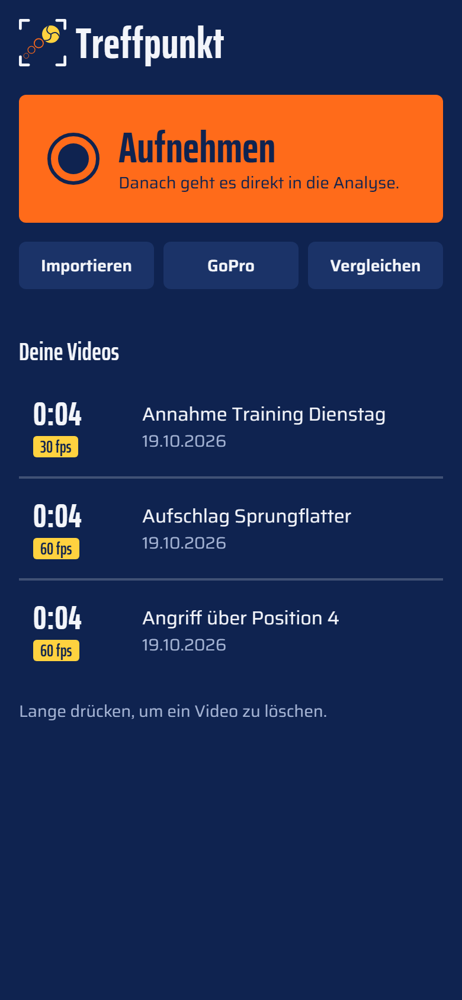
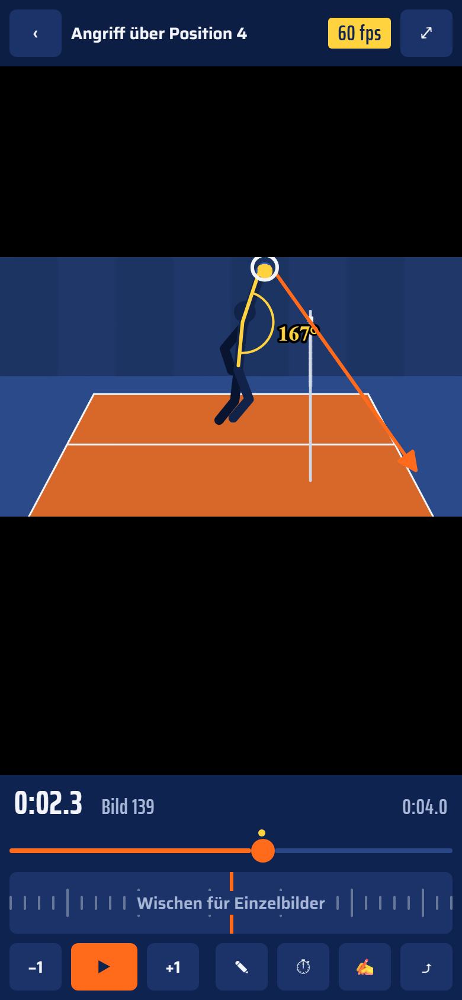
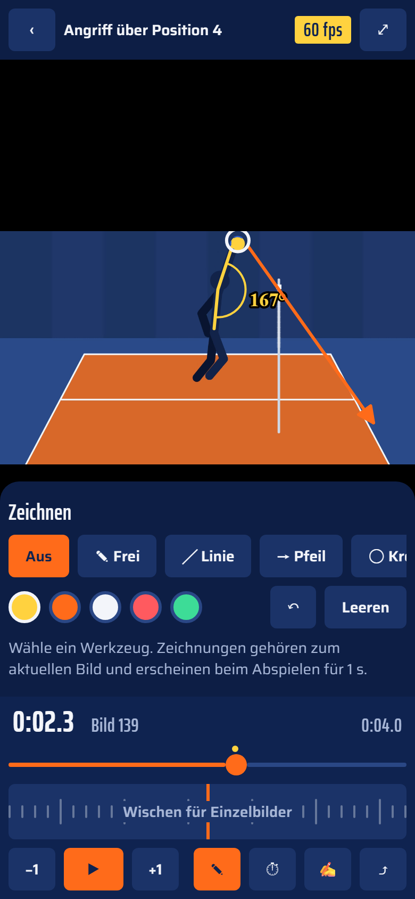
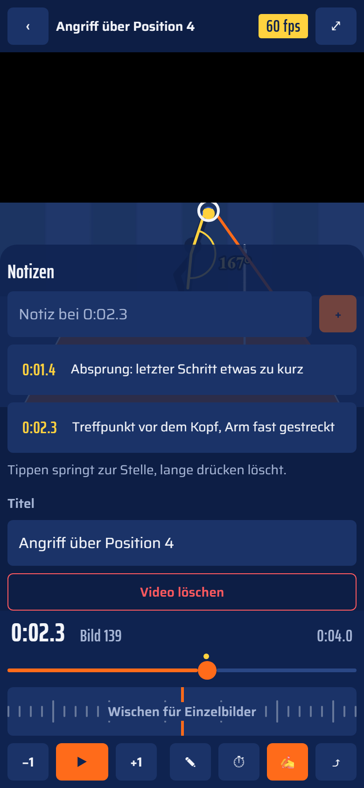
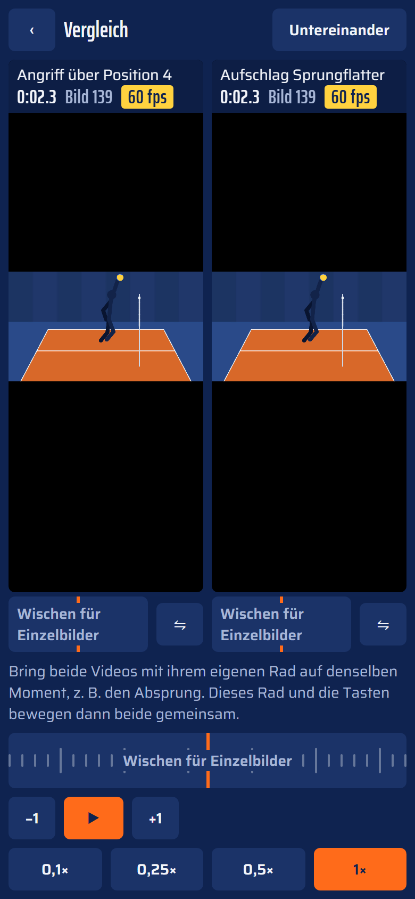
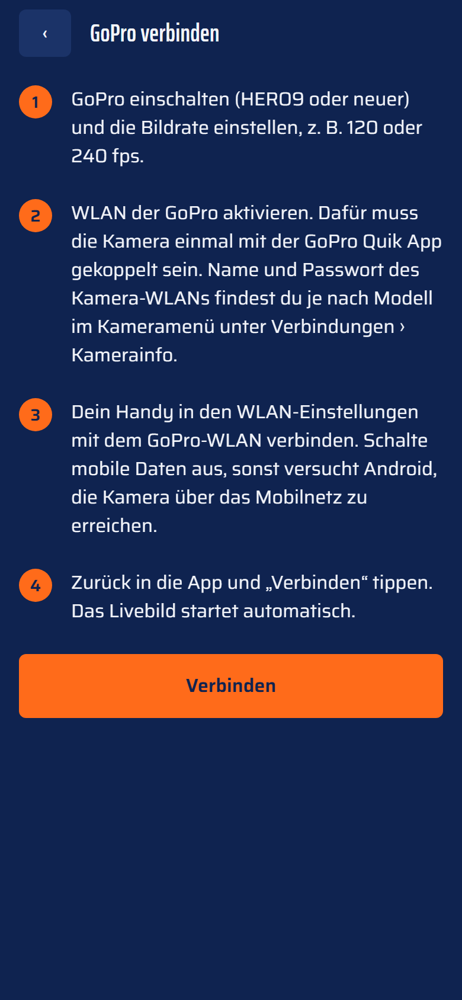

# Treffpunkt

Videoanalyse für Volleyball: Aktion aufnehmen oder importieren, Bild für Bild durchgehen, einzeichnen, vergleichen.

Treffpunkt ist für Trainer und Spieler gedacht, die direkt in der Halle eine Szene analysieren wollen, etwa Angriff, Aufschlag oder Annahme. Es gibt keine Formulare und keine Technik-Kategorien: Video aufnehmen, und die Analyse ist offen. Vorbild ist Dartfish Express. Alles bleibt auf dem Gerät, die App braucht weder Konto noch Server.

<table>
  <tr>
    <td align="center"><br><sub>Videos</sub></td>
    <td align="center"><br><sub>Analyse</sub></td>
    <td align="center"><br><sub>Zeichnen</sub></td>
  </tr>
  <tr>
    <td align="center"><br><sub>Notizen</sub></td>
    <td align="center"><br><sub>Vergleich</sub></td>
    <td align="center"><br><sub>GoPro</sub></td>
  </tr>
</table>

<sub>Die Screenshots stammen aus der Web-Version mit einem gezeichneten Demo-Clip. Auf dem Handy sieht die App genauso aus.</sub>

## So läuft eine Analyse

1. **Aufnehmen** tippen oder ein Video importieren, z. B. eine Slo-Mo-Aufnahme aus der Galerie oder von der GoPro.
2. Die Analyse öffnet sich sofort. Mit dem Jog-Wheel wischst du Bild für Bild zum entscheidenden Moment, etwa Absprung oder Treffpunkt. Mit **−1** und **+1** springst du um genau ein Bild.
3. Über **✎** zeichnest du direkt ins Bild: Armwinkel messen, Flugbahn als Pfeil, Ball einkreisen.
4. Über **✍** hältst du Notizen fest. Jede Notiz bekommt den aktuellen Zeitstempel, ein Tipp darauf springt zurück an die Stelle.
5. Über **⏱** spielst du die Szene in Zeitlupe oder als A–B-Schleife ab. Über **⤴** teilst du ein Standbild mit Zeichnungen oder das Originalvideo.

Zum Vergleichen tippst du auf der Startseite auf **Vergleichen** und wählst zwei Videos. Jedes Video bringst du mit seinem eigenen Rad auf denselben Moment, danach laufen beide gemeinsam.

## Funktionen

- **Aufnehmen oder importieren:** Die Analyse öffnet sich direkt danach. Beim Import bleibt die Originaldatei mit ihrer vollen Bildrate erhalten, z. B. Slo-Mo mit 240 fps.
- **Analyse im Vollbild**
  - Jog-Wheel für Einzelbilder, Zeitlupe von 0,1× bis 1×, A–B-Schleife, Spiegeln
  - Bildrate des Videos immer im Blick
- **Zeichnen:** Freihand, Linie, Pfeil, Kreis und Winkel mit Gradanzeige. Die Zeichnungen werden pro Bild gespeichert.
- **Notizen** mit Zeitstempel
- **Vergleich:** zwei Videos nebeneinander oder untereinander. Erst einzeln ausrichten, dann gemeinsam abspielen.
- **GoPro (HERO9 und neuer):** Aufnahme fernsteuern und Videos mit hoher Bildrate über das Kamera-WLAN übertragen (Open GoPro HTTP API)
- **Export:** Standbild mit Zeichnungen und Originalvideo teilen oder in der Galerie speichern

## Entwicklung

Expo SDK 58, Expo Router, expo-video, expo-sqlite.

```bash
npm install
npx expo start          # mit Expo Go scannen; --tunnel, wenn das WLAN blockiert
npx expo start --web    # Web-Version im Browser, z. B. für Screenshots
npx expo lint
npx tsc --noEmit
```

Neue Pakete immer mit `npx expo install <paket>` hinzufügen.

## Aufbau

| Pfad | Inhalt |
| --- | --- |
| `src/app/` | Screens: Videos, Analyse, Vergleich, GoPro |
| `src/components/` | Jog-Wheel, Zeichenebene, Standbild-Export, Logo, Buttons |
| `src/hooks/use-frame-player.ts` | Videoplayer mit bildgenauem Springen |
| `src/lib/` | Datenbank, GoPro-Schnittstelle, Export, Formatierung |
| `src/constants/theme.ts` | Hallen-Palette, Schriften, Abstände |
| `assets/logo/` | Logo als SVG |
| `docs/screenshots/` | Screenshots für diese README |
| `metro.config.js` | Web: wasm für expo-sqlite und COOP/COEP-Header |

## Design

Die Farben kommen aus der Volleyballhalle: Freizone-Blau `#0F2350`, Spielfeld-Orange `#FF6B1A`, Ball-Gelb `#FFD23F` und Netzband-Weiß `#F3F5FA`. Die Schriften sind Saira für Text und Saira ExtraCondensed für Zahlen und Überschriften. Das Logo zeigt den Ball, wie er Bild für Bild zum Treffpunkt steigt, im Sucherrahmen einer Kamera.

## Grenzen in Expo Go

- Die eigene Kamera der App filmt nicht mit wählbarer Bildrate. Für hohe fps nimmst du in der System-Kamera im Slo-Mo-Modus auf und importierst das Video, oder du nutzt eine GoPro.
- Videos mit eingebrannten Zeichnungen und das GoPro-Livebild brauchen einen eigenen Build (`eas build --profile development`).
